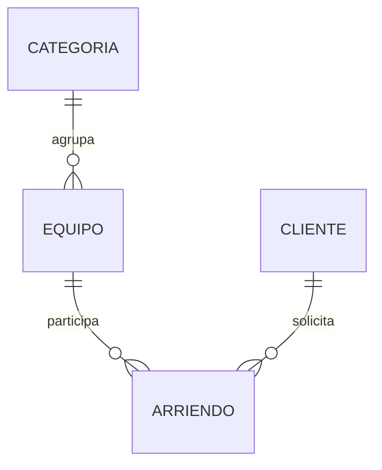

# BOCETO

este proyecto fue hecho gracias a Don IAn Hernandez De La Cruz 

## Proyecto final: arriendo de equipamiento deportivo

Implementación de referencia para estudiar Programación II, UCT. Basada en la rúbrica de Evaluación 3 entregada por el docente. Debes comprenderla, probarla en tu equipo y adaptar su presentación antes de entregar. La interrogación individual vale **30 de los 130 puntos**.

## Qué pide el proyecto

Aplicación de escritorio en **Python + Tkinter**, datos persistentes en **SQLite mediante SQLAlchemy ORM**, dos gráficos con **Matplotlib** y uso justificado de **Factory Method**. Entrega indicada en el PDF: **1 de diciembre de 2026**, individual o máximo dos alumnos.

- CRUD de categorías, equipos y clientes.
- Registrar arriendos de un equipo y varias unidades, descontando stock en la misma transacción.
- Devolver un arriendo completo una sola vez y restituir exactamente su cantidad.
- Consultar disponibles, activos e historial.
- Validar fechas, stock, referencias y datos únicos.
- Dos gráficos: operaciones por categoría y equipos con más operaciones. No sumar unidades.
- Documentación, fuentes, pruebas y explicación técnica.

## Instalación y ejecución

Requiere Python 3.10 o superior y soporte Tkinter del sistema.

```bash
cd proyecto_final_deportes
python -m venv .venv
```

Activa el entorno en Linux/macOS:

```bash
source .venv/bin/activate
```

O en Windows PowerShell:

```powershell
.venv\Scripts\Activate.ps1
```

Instala y comprueba Tkinter:

```bash
python -m pip install -r requirements.txt
python -m tkinter
```

El segundo comando debe abrir una ventana. Si falta Tkinter, instala el paquete de Python/Tk correspondiente a tu distribución; no se instala desde este requirements.txt.

```bash
python main.py
```

No se necesita servidor ni XAMPP. Al iniciar se crean las tablas en `datos/deportes.db`, junto al código, independientemente de la carpeta de la terminal. La información permanece al cerrar. No borres ese archivo para reiniciar la aplicación.

Opcional, para generar datos de ejemplo en una base vacía:

```bash
python seed.py
```

Si ya hay categorías, equipos o clientes, el comando se niega a cargar la demostración. Usa una ruta nueva para una prueba independiente, por ejemplo en Linux/macOS:

```bash
DEPORTES_DB=/tmp/deportes_demo.db python seed.py
DEPORTES_DB=/tmp/deportes_demo.db python main.py
```

La carga de ejemplo utiliza datos ficticios, crea un arriendo devuelto y uno activo. Para seguir exactamente la prueba de stock 5 → 3 → 5, crea otro equipo o usa una base vacía.

## Uso de la interfaz

1. **Categorías:** ingresa nombre y descripción y pulsa Guardar.
2. **Equipos:** ingresa nombre, elige categoría y tipo; completa precio diario y stock total. El disponible inicial es igual al total.
3. **Clientes:** ingresa nombre, correo y teléfono.
4. Para editar un catálogo, selecciona su fila, modifica el formulario y guarda. Nuevo / limpiar inicia otra alta.
5. **Arriendos y devoluciones:** selecciona equipo y cliente; ingresa cantidad y fechas AAAA-MM-DD. Pulsa Registrar arriendo.
6. Selecciona un arriendo en la tabla y pulsa Devolver seleccionado. Confirma la devolución completa.
7. Sin el filtro Solo activos se muestra el historial. Solo equipos disponibles filtra la lista de equipos para arrendar.
8. **Gráficos:** muestra los dos gráficos desde la base actual. Las operaciones de la interfaz también los actualizan.

Al editar stock total se conserva la cantidad de unidades arrendadas: `disponible = nuevo_total - unidades_activas`. No se permite reducirlo por debajo de lo actualmente arrendado. El tipo de un equipo se conserva al editarlo.

## Modelo y decisiones



- Categoria: nombre único y descripción.
- Equipo: categoría, precio decimal positivo, stock total y disponible. Las restricciones CHECK protegen los límites en SQLite.
- Cliente: nombre, correo único y teléfono. El servicio normaliza el correo a minúsculas.
- Arriendo: equipo, cliente, fechas, cantidad y estado ACTIVO o DEVUELTO.
- No se eliminan clientes o equipos con historial, ni categorías con equipos. La interfaz explica el motivo; no se aplica borrado en cascada del historial.
- SQLite activa `PRAGMA foreign_keys=ON` para cada conexión.
- `Session.begin()` agrupa los cambios de cada caso de uso. Ante error se revierte la transacción.
- El descuento de stock usa un UPDATE condicionado a disponibilidad suficiente; una devolución cambia el estado solo si aún era ACTIVO.
- Los gráficos usan COUNT(Arriendo.id), incluyendo activos y devueltos; los diez equipos más arrendados se ordenan por cantidad de operaciones. Un arriendo de 5 unidades cuenta como 1 operación.
- Los gráficos atribuyen el historial a la categoría actual del equipo. No se conserva una copia histórica de la categoría.
- Es una aplicación local de escritorio. No incluye autenticación, servidor web, devoluciones parciales, multas ni cobros, porque no son requisitos del enunciado.
- `create_all` crea tablas nuevas; no reemplaza migraciones para modificar una base antigua con otro esquema. Este proyecto utiliza su propia base de datos separada.

## Factory Method integrado con ORM

`CreadorEquipo` define `factory_method()` y el flujo común `crear(...)`. `CreadorGeneral`, `CreadorPelota` y `CreadorBicicleta` redefinen el método para construir distintos productos (`Equipo`, `Pelota`, `Bicicleta`). El servicio elige un creador y guarda el objeto ORM resultante con `session.add`.

Los tres productos comparten la tabla `equipo`. SQLAlchemy utiliza el discriminador `tipo` y la herencia de tabla única para recuperar la subclase correcta. Cada producto implementa instrucciones de entrega distintas, visibles con el botón del catálogo de equipos. La categoría es una clasificación editable; el tipo define el comportamiento del objeto.

Esto es Factory Method porque las subclases creadoras redefinen el método de construcción. El diccionario CREADORES solo permite elegir el creador; por sí solo no constituye el patrón.

## Archivos y orden de estudio

| Archivo | Para qué sirve |
|---|---|
| conexion.py | Motor, ruta SQLite, claves foráneas, sesiones y creación de tablas |
| modelos.py | Entidades ORM, restricciones, relaciones y subtipos de equipos |
| validaciones.py | Texto, correo, precio, enteros y fechas |
| fabricas.py | Creador abstracto y creadores concretos de Factory Method |
| servicios.py | CRUD, arriendos, devoluciones y consultas estadísticas |
| informes.py | Figura de Matplotlib basada en consultas a la base |
| interfaz.py | Pestañas, formularios, tablas, botones y mensajes Tkinter |
| main.py | Configura la base e inicia la aplicación |
| seed.py | Genera datos ficticios si la base está vacía |
| pruebas/test_sistema.py | Pruebas automáticas de reglas y persistencia en bases temporales |
| docs/GUIA_ESTUDIO.md | Explicación y preguntas para preparar la interrogación |
| docs/PRUEBAS.md | Recorrido de demostración, evidencia y comprobaciones manuales |

Orden recomendado: conexión → modelos → validaciones → fábricas → servicios → informes → interfaz → main. Primero prueba las reglas sin ventana y después relaciona cada botón con el servicio correspondiente.

## Pruebas

Desde esta carpeta:

```bash
python -m unittest discover -s pruebas -v
```

Las ocho pruebas automatizadas utilizan SQLite temporal y no modifican tus datos. Ver [evidencia y pruebas manuales](docs/PRUEBAS.md).

**Estado de esta versión:** lógica y generación de gráficos probadas automáticamente; la ventana Tkinter no pudo abrirse en el entorno de preparación. Falta ejecutarla en un escritorio real, completar las comprobaciones manuales y añadir capturas de sus pestañas antes de entregar. No se presentan capturas simuladas como evidencia.

## Fuentes consultadas

- [Python: Tkinter](https://docs.python.org/3/library/tkinter.html): ventana raíz, eventos y mainloop.
- [Python: ttk](https://docs.python.org/3/library/tkinter.ttk.html): Notebook, Treeview y Combobox.
- [SQLAlchemy: sesiones y transacciones](https://docs.sqlalchemy.org/en/20/orm/session_basics.html): Session.begin, commit y rollback.
- [SQLAlchemy: herencia de tabla única](https://docs.sqlalchemy.org/en/20/orm/inheritance.html#single-table-inheritance): discriminador y productos persistentes.
- [Matplotlib: integración en Tk](https://matplotlib.org/stable/gallery/user_interfaces/embedding_in_tk_sgskip.html): FigureCanvasTkAgg.
- [Factory Method, Refactoring Guru](https://refactoring.guru/design-patterns/factory-method): estructura de creador, productos y redefinición del método de fabricación.

La implementación y las explicaciones de esta carpeta se elaboraron como referencia de práctica. No basta con ejecutarlas: prepara la explicación de cada decisión y sigue las reglas de tu curso sobre uso de asistencia.
